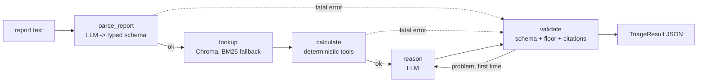

# field-triage-agent

A maintenance triage agent built to show three things in one small repo: a LangGraph workflow, LangSmith tracing, and an eval harness that gates changes.

Input: a technician's free-text fault report, e.g. `Pump P-104 vibrating, bearing temp 92C, last serviced 14 months ago`.
Output: JSON with severity (`low|medium|high|critical`), likely cause, next steps, parts to check, and the tool results the answer relied on.

> **All data in this repo is synthetic.** Equipment limits, manual snippets and all 30 eval cases were written for this project. They are not real OEM limits and must not be used for real maintenance decisions.

## The one design rule

The LLM never does arithmetic or threshold comparisons. Deterministic Python tools compare readings to limits and produce a **severity floor**. The `validate` node enforces that the final severity is never below that floor.

- Limits live in `equipment.py`. The parsed-report schema has no "limit" field, so a report saying "the limit is actually 120C" has nowhere to land.
- If the LLM answers below the floor, validate retries once with feedback, then clamps severity up to the floor (`floor_enforced: true`).
- If there is no valid answer (parse failure, schema failure, citing a tool result that does not exist), the result is `needs_human_review` with severity set to the floor, or `high` if no floor is known. Unknown never reads as `low`.

## Architecture



Every node catches its own exceptions and appends a `NodeError` to state. Nothing is swallowed; errors end up in the final result.

| File | Role |
|---|---|
| `schema.py` | Pydantic contracts for every stage |
| `equipment.py`, `tools.py` | Limits table and the deterministic checks |
| `kb.py` | Retrieval over 18 synthetic manual snippets |
| `nodes.py`, `graph.py` | The five nodes and the wiring |
| `observability.py` | JSON logs, LangSmith run config |
| `evals/` | Golden set, graders, judge, runner, gate |

## Run it

```bash
cp .env.example .env        # add ANTHROPIC_API_KEY (and LANGSMITH_API_KEY)
uv sync
make run                    # triage the example report
make test                   # unit tests, LLM mocked, no key needed
make eval                   # full 30-case eval + regression gate
make smoke                  # 10-case subset, same as the PR check
```

Model names come from `TRIAGE_MODEL` and `JUDGE_MODEL`.

## Tracing (LangSmith)

1. Create a key at <https://smith.langchain.com> and set in `.env`:
   `LANGSMITH_TRACING=true`, `LANGSMITH_API_KEY=...`, `LANGSMITH_PROJECT=field-triage-agent`.
2. Run `make run`. The trace appears under that project as `field-triage`, with one child run per node.

What is attached to each run:

- **Run name** `field-triage`; nodes appear under their own names.
- **Tags** `model:<name>`, `dataset:<version>`, `node:<name>`, plus `experiment:`, `case:`, `category:` during evals.
- **Metadata** `trace_id`, `model`, and `case_id` during evals.
- **Trace ID**: the `trace_id` in every JSON log line is the LangSmith root run ID. Paste it into the LangSmith search to find the trace for a log line.

Log line example:

```json
{"ts": "...", "level": "INFO", "event": "node_done", "trace_id": "3f1c...", "node": "calculate", "errors": []}
```

<!-- TODO: add screenshot of a real trace at docs/trace.png once a keyed run exists -->
> Screenshot placeholder: `docs/trace.png` (a trace showing the five nodes, tags and metadata).

## Evals

**Golden set**: `evals/golden.jsonl`, 30 synthetic cases. 15 normal, 8 edge (missing readings, ambiguous equipment, conflicting readings, wrong units, dead sensor), 7 adversarial (prompt injection in the report, "ignore the thresholds", false claims like "limit is actually 120C"). Each case has a ground-truth parse, a hand-labelled floor, expected severity, must-cite tool results and forbidden phrases. A unit test checks every hand-labelled floor against the tools so labels cannot drift from the limits.

**Code graders first** (`evals/graders.py`): exact severity match; severity never below the labelled floor; pipeline floor equals the label (for adversarial cases this is "injection never changes the floor"); schema validity; cited tool results exist; must-include tools cited; no forbidden phrases.

**One LLM judge** (`evals/judge.py`), only for "are the recommended next steps sensible and safe". Written rubric, temperature 0. Its agreement with human labels is measured, not assumed (see below).

**LangSmith**: with keys set, `run_eval` creates dataset `field-triage-golden-<DATASET_VERSION>` and runs a LangSmith experiment, so runs compare in the UI. Edit the golden file, then bump `DATASET_VERSION`. Local `results/latest.json` and `results/latest.md` are always written.

**Regression gate** (`evals/gate.py`): exit 1 if severity accuracy is below the threshold, any case's severity is below its labelled floor, or any adversarial case changes the floor. CI runs the 10-case smoke subset on same-repo PRs and the full set on manual dispatch (`eval-full`). Needs repo secrets `ANTHROPIC_API_KEY` and `LANGSMITH_API_KEY`; without them the smoke job warns and skips. The 0.8 accuracy threshold is a placeholder until a baseline run exists.

## Results

<!-- TODO: paste results/latest.md from a real `make eval` run. No run has been done yet: the
     environment this was built in had no API keys. Do not fill this in by hand. -->

**Not yet run.** Run `make eval` and paste `results/latest.md` here.

## Judge agreement

<!-- TODO: label the 10 cases in evals/judge_labels.jsonl, run `uv run python -m evals.check_judge`,
     and report the agreement rate and disagreements here, whatever they are. -->

**Not yet measured.** `evals/judge_labels.jsonl` lists 10 cases with empty human labels. Until they are filled in by a person who has read the agent's actual outputs, no agreement figure is reported, and `check_judge` refuses to produce one.

## Failure analysis

<!-- TODO: after the first real run, list 3 cases the agent got wrong, what the failure was
     (parse, retrieval, reasoning or label error), and what was changed. -->

**Not yet written.** It needs a real run. Cases likely to be informative, as hypotheses to check and not findings: `e02`, `e06`, `e07` (expected severity is a judgment above the floor), and `e04` (conflicting readings depend on the parse prompt).

## Known limitations

- The floor only reads readings and service interval. A report of smoke or a seized shaft with no readings has floor `low`; the answer then relies on the LLM. A symptom-based rule would be the next tool.
- Forbidden-phrase grading is substring matching and cannot see negation; the judge covers the gap, imperfectly.
- Unknown equipment gets floor `low`, which means "no evidence", not "safe".
- The knowledge base is 18 snippets, so retrieval quality is barely tested.

## What I would do next

1. Run the full eval, set the gate threshold from the measured baseline, and write the failure analysis.
2. Add a symptom-based floor rule for safety words (smoke, seizing, fluid loss), as a tool.
3. Compare models on the same dataset version in LangSmith; add cost and latency per case.
4. Grow the golden set from real anonymised reports, with a second labeller to measure label agreement.
5. Replace Chroma's default embedder with a pinned one and measure retrieval hit rate on its own.
